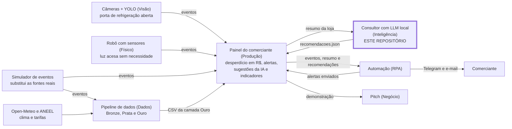

# Energia que dá Lucro · Consultor de Eficiência Energética

**FIAP · Global Solution 2026.2 · CitizenTech · 4ES · Generative AI for Engineering**
Componente **Inteligência** do produto: uma LLM local que recomenda ao comerciante como reduzir o desperdício de energia, citando a fonte, e que responde "não consta" quando a base não cobre o assunto.

O relatório completo, com diagrama, tabela da base, placar interpretado e os cinco erros, está em **[RELATORIO.md](RELATORIO.md)**.

## Integrantes

| Nome completo | RM |
|---|---|
| Gustavo Henrique Santos Bonfim | RM98864 |
| João Pedro Marques | RM98307 |
| Kayky Paschoal Ribeiro | RM99929 |
| Lucas Yuji Farias Umada | RM99757 |
| Natan Eguchi dos Santos | RM98720 |

## Ficha Técnica do MVP

| Campo | Conteúdo |
|---|---|
| Nome do produto | Energia que dá Lucro (nome provisório) |
| Cidadão e território | Donos e funcionários de pequenos comércios de bairro (mercadinhos, padarias, açougues, lojas) em cidades brasileiras |
| Problema, em uma frase | O pequeno comerciante paga caro de energia sem saber quais hábitos e equipamentos causam o desperdício |
| Proposta de valor | Mostrar o desperdício em reais, avisar na hora em que ele acontece e sugerir ações simples, usando as câmeras que a loja já tem |
| Arquitetura: componentes | Detecção por câmera (Visão) · robô com sensores (Físico) · API e painel do comerciante (Produção) · pipeline de dados (Dados) · **consultor de eficiência com LLM local (Inteligência, este repositório)** · alertas e resumos automáticos (Automação) · modelo de negócio (Pitch) |
| Fontes de dados | Clima (Open-Meteo) · tarifas e bandeiras (ANEEL) · eventos e consumo das lojas (simulados, com geração documentada) |
| Modelos de IA utilizados | YOLO treinado para portas de refrigeração abertas · **LLM local `qwen2.5:7b` com base de conhecimento (RAG) e agente com ferramentas; embeddings `bge-m3`** · IA embarcada no robô |
| URL do MVP e repositório | MVP: sem URL pública nesta entrega. É uma landing page com um painel administrativo em que o cliente vê os dashboards; o painel recebe o JSON de recomendações gerado aqui (`saida/recomendacoes.json`) · Repositório: <https://github.com/GBonfim07/GS-IA-4ESR> |
| Indicadores de impacto | R$ e kWh de desperdício evitados por loja ao mês · tempo médio de porta aberta · percentual de alertas resolvidos em poucos minutos · número de lojas ativas |
| ODS conectados | ODS 7 e ODS 12 (mais diretos); do slide oficial, ODS 9, 11 e 13 |

**O que a IA resolve.** O painel mostra quanto a loja desperdiçou; o Consultor diz o que fazer. Ele recebe o resumo de desperdício da loja ou uma pergunta do comerciante e devolve uma recomendação em JSON com a fonte citada. Se a base não cobre o assunto, responde "não consta" em vez de inventar. Dos três problemas do enunciado (energia, segurança ou mobilidade), o escolhido é **energia**.

**Resultado.** O mesmo modelo local, medido em 44 perguntas de teste:

| Configuração | Acerto | Alucinação |
|---|---:|---:|
| 1. Modelo puro, sem contexto | 31,8% | 40,9% |
| 2. RAG simples | 72,7% | 2,3% |
| 3. Agente com ferramentas | **90,9%** | 4,5% |

**As seis perguntas do briefing.**

| Pergunta | Resposta do grupo |
|---|---|
| Quem é o cidadão beneficiado? | O pequeno comerciante de bairro |
| Qual problema será resolvido? | O desperdício de energia que ele não consegue identificar sozinho |
| Como a solução funcionará? | Detecta o desperdício, alerta na hora, mostra o custo e sugere ações |
| Quais tecnologias serão empregadas? | Visão computacional, sensores, LLM local, pipeline de dados, automação e nuvem |
| Quem participará do ecossistema? | Comerciantes, associações comerciais, distribuidoras de energia e órgãos de apoio ao pequeno negócio |
| Como o impacto será medido e ampliado? | Pelos indicadores da Ficha Técnica, acompanhados no painel por loja e por mês |

**Como o produto contribui para os ODS.**

| ODS | Meta relacionada | Como contribui |
|---|---|---|
| 7 · Energia acessível e limpa | 7.3, melhorar a eficiência energética | Reduz o consumo de energia do pequeno comércio com orientação tirada de fontes oficiais (ANEEL, PROCEL) |
| 12 · Consumo e produção responsáveis | 12.2, uso eficiente dos recursos, e 12.3, reduzir a perda de alimentos no varejo | Ataca o desperdício de energia sem comprometer a conservação dos alimentos, porque a base inclui as temperaturas exigidas pela Anvisa |
| 9 · Indústria, inovação e infraestrutura | 9.4, mais eficiência no uso de recursos e adoção de tecnologias limpas | Leva IA ao pequeno negócio com o que ele já tem: as câmeras da loja e uma LLM que roda em computador comum, sem nuvem |
| 11 · Cidades e comunidades sustentáveis | 11.6, reduzir o impacto ambiental das cidades | Reduz o consumo de energia do comércio de bairro, que faz parte do dia a dia da cidade |
| 13 · Ação contra a mudança global do clima | 13.3, conscientização e capacidade para a mitigação | Mostra ao comerciante, em reais e em kWh, o efeito de cada hábito, e explica as bandeiras tarifárias, que sinalizam quando as condições de geração pioram |

Os ODS 9, 11 e 13 estão na lista do slide oficial do desafio. Os ODS 7 e 12 não estão na lista, mas são os mais diretos para o tema energia.

## O produto inteiro e onde este componente se encaixa

O Energia que dá Lucro é um único produto que atravessa as sete disciplinas da Global Solution. Cada disciplina constrói um componente do mesmo sistema.

**Como funciona, em uma frase:** as câmeras de segurança e um pequeno robô com sensores percebem o desperdício (geladeira aberta, luz acesa sem necessidade); o comerciante recebe um alerta na hora e depois vê no painel quanto isso custou e o que fazer para gastar menos. A parte "o que fazer" é a deste repositório.



### As sete disciplinas e a ligação de cada uma com o Consultor

| Disciplina | Componente | O que faz no produto | Ligação com este repositório |
|---|---|---|---|
| **Generative AI for Engineering** | Inteligência | LLM local que recomenda o que fazer, com fonte citada e recusa quando não sabe | **É este repositório** |
| Secure DevOps Tools & Cloud Computing | Produção | Painel do comerciante: uma landing page com um painel administrativo em que o cliente vê os dashboards. É o centro do produto | Fornece o resumo de desperdício da loja e recebe o nosso `saida/recomendacoes.json`, que alimenta a tela de sugestões |
| Big Data Architecture & Data Integration | Dados | Coleta clima, tarifas e eventos, trata em camadas (Bronze, Prata, Ouro) e entrega os indicadores ao painel | Sem troca direta. Usa as mesmas lojas, os mesmos equipamentos e o mesmo formato de evento dos nossos dados simulados |
| Applied Computer Vision | Visão | Modelo YOLO que detecta porta de expositor ou freezer aberta e gera eventos `porta_aberta` | Indireta: esses eventos formam o resumo que o Consultor lê. A recomendação fala do equipamento que a câmera apontou |
| Project-Based Maker Lab | Físico | Robô com sensor de luminosidade que gera eventos `luz_acesa_sem_necessidade` | Indireta, do mesmo jeito, para `iluminacao-salao` e `iluminacao-estoque` |
| Robotic Process Automation | Automação | Envia o alerta na hora pelo Telegram e o resumo por e-mail, e registra os alertas no painel | Usa o texto das nossas recomendações no resumo por e-mail |
| Business Intelligence & Startup Development | Negócio e pitch | Vídeo pitch com a demonstração do MVP, o modelo de negócio e os indicadores | A sugestão da IA é uma das telas da demonstração; os indicadores de impacto são os da Ficha Técnica |

As linhas das outras disciplinas resumem o plano do grupo. Cada uma tem a sua própria entrega e o seu repositório; este repositório demonstra só o lado do Consultor.

### O que mantém as partes compatíveis

Todas as entregas seguem o mesmo contrato de dados, definido no guia do grupo ([`docs/contrato_de_dados.md`](docs/contrato_de_dados.md)):

- **Mesmas lojas e equipamentos fictícios:** `padaria-01` e `mercado-01`, com `expositor-1`, `freezer-1`, `iluminacao-salao` e os demais.
- **Mesmo formato de evento de desperdício:** loja, equipamento, tipo, origem, início, duração e custo estimado.
- **Mesma fórmula de custo:** `potencia_kw × fator_perda × (duracao_s / 3600) × tarifa_rs_kwh`. O Consultor usa a fórmula como ferramenta de cálculo e como trecho citável da base (`produto-contrato-01`).
- **Mesmo formato de recomendação:** `loja_id`, `periodo`, `nao_consta`, `recomendacao` e `fonte`.

### Estado da integração nesta entrega

| | Como está | Evidência |
|---|---|---|
| Entrada | Resumo da loja no formato do `GET /summary`. Vem de arquivos simulados, gerados com semente fixa | [`dados/`](dados/) e [`dados/README.md`](dados/README.md) |
| Saída | Arquivo com 12 recomendações, três para cada loja e mês, no contrato do grupo. A troca com o painel é por arquivo, como o guia do grupo prevê | [`saida/recomendacoes.json`](saida/recomendacoes.json), conferido por teste automático |
| API local | Recebe uma pergunta ou o resumo de uma loja e devolve a recomendação no mesmo contrato | [seção API](#api) |
| Leitura ao vivo do painel | Implementada: com a variável `PAINEL_URL`, o resumo é lido da API do painel, e o arquivo local é usado se ela estiver fora do ar. **Não foi testada contra o painel real** | [`src/consultor/resumo.py`](src/consultor/resumo.py) |
| Tela de sugestões | Fica na entrega do painel (Secure DevOps), fora deste repositório | |

## Como o Consultor funciona

1. **Preparação da base, feita uma vez.** 14 documentos públicos (ANEEL, Anvisa, PROCEL, ANA, MME e EPE, mais o contrato do grupo) são cortados por assunto em 56 trechos, cada um com fonte, licença e localização no original. Cada trecho vira um vetor com o modelo de embeddings `bge-m3`.
2. **Chega uma pergunta do comerciante ou o resumo de uma loja.**
3. **Busca.** O sistema procura os três trechos mais parecidos com a pergunta.
4. **Primeira chance de recusar.** Se o melhor trecho tem similaridade abaixo de 0,56, a resposta é "não consta" e a LLM nem é chamada.
5. **Geração.** A LLM local (`qwen2.5:7b`) recebe os trechos e precisa copiar a frase que sustenta a resposta antes de responder. Sem evidência, recusa.
6. **Verificação.** O código confere se a saída é um JSON válido no contrato e se o trecho citado está entre os que o modelo recebeu. Se não estiver, a resposta é descartada.
7. **Saída.** Recomendação em JSON com a fonte, mais o campo `explicacao`, que diz o que foi consultado e por que a decisão foi tomada.

O mesmo modelo é medido em três configurações, e a diferença entre elas é a prova pedida pela disciplina:

| Configuração | O que o modelo recebe | Para que serve |
|---|---|---|
| 1. Modelo puro | Só a pergunta | Linha de base: mostra o que o modelo inventa sem contexto |
| 2. RAG simples | A pergunta e os três trechos da busca | Resposta com fonte e recusa quando a base não cobre |
| 3. Agente com ferramentas | O mesmo do RAG, mais quatro ferramentas que ele decide quando usar: buscar de novo, ler o resumo da loja, calcular o desperdício e uma calculadora | Perguntas que dependem dos números da loja ou de uma conta exata |

**Especialização sem treinar os pesos.** A rubrica aceita LoRA ou agente; escolhemos o agente e o modelo não foi re-treinado. O motivo está em [Decisões e desafios do percurso](#decisões-e-desafios-do-percurso).

**Geração em lote para o painel.** Para cada loja e mês, o script pega os três equipamentos que mais desperdiçaram, monta a pergunta com os números do resumo e gera uma recomendação para cada um com o RAG. Antes de gravar, o código confere se o valor em reais citado no texto é o do resumo.

O diagrama completo do pipeline está no [RELATORIO.md, seção 03](RELATORIO.md).

## O que há no repositório

```
base/           fontes.json (14 fontes com URL e licença), trechos.jsonl (56 trechos), indice/
avaliacao/      casos_teste.jsonl (74 casos com gabarito), resultados/, placar_teste.md,
                revisao_manual.json, erros_selecionados.json, limiar.json, iteracoes/,
                repeticao/ (segunda execução do teste, para medir a variação entre rodadas)
notebooks/      01 base e busca · 02 geração com RAG · 03 agente · 04 placar e erros (saídas salvas)
src/consultor/  busca, geração, agente, ferramentas, avaliação e API
scripts/        avaliar_busca.py · avaliar.py · gerar_recomendacoes.py · simular_eventos.py · montar_notebooks.py
dados/          eventos e resumos simulados das lojas (entrada)
saida/          recomendacoes.json (o que o painel e a automação consomem)
tests/          testes que rodam sem a LLM
docs/           contrato de dados com o painel
```

| Critério da rubrica | Onde está |
|---|---|
| 01 Tarefa da IA e casos de teste com gabarito, incluindo "não consta" | [RELATORIO.md §02](RELATORIO.md) · [`avaliacao/casos_teste.jsonl`](avaliacao/casos_teste.jsonl) (21 casos "não consta") |
| 02 Base de conhecimento, em trechos com fonte | [`base/`](base/) · [RELATORIO.md §04](RELATORIO.md) · notebook 01 |
| 03 Busca com recall@1 e recall@3 medidos e limiar justificado | notebook 01 · [RELATORIO.md §5.2 e §5.3](RELATORIO.md) · [`avaliacao/busca.json`](avaliacao/busca.json) |
| 04 Geração fundamentada: JSON válido, citação da fonte e recusa | [`src/consultor/geracao.py`](src/consultor/geracao.py) · notebook 02 |
| 05 Especialização (agente) comparada ao RAG simples | [`src/consultor/agente.py`](src/consultor/agente.py) · notebook 03 |
| 06 Placar das três configurações, com resultados interpretados | [RELATORIO.md §5.4 e §5.5](RELATORIO.md) · notebook 04 · [`avaliacao/placar_teste.md`](avaliacao/placar_teste.md) |
| 07 Cinco erros reais com proposta de correção | [RELATORIO.md §06](RELATORIO.md) · notebook 04 · [`avaliacao/erros_selecionados.json`](avaliacao/erros_selecionados.json) |
| 08 README e reprodutibilidade | este arquivo |

## Como reproduzir

Testado em Windows 11, Python 3.13, Ollama 0.40.16 e GPU Radeon RX 7800 XT (16 GB). Funciona também só com CPU, mais devagar. São necessários cerca de 6 GB de disco para os modelos.

**1. Instale o Ollama** ([ollama.com](https://ollama.com)) e baixe os dois modelos:

```bash
ollama pull qwen2.5:7b
```

```bash
ollama pull bge-m3
```

**2. Instale as dependências do Python** (3.11 ou mais novo):

```bash
pip install -r requirements.txt
```

**3. Rode os testes que não dependem da LLM** (base, ferramentas, contrato e API):

```bash
python -m pytest -q
```

**4. Monte o índice, meça a busca e calibre o limiar** (cerca de 1 minuto):

```bash
python scripts/avaliar_busca.py
```

**5. Rode o placar das três configurações** (cerca de 10 minutos com GPU):

```bash
python scripts/avaliar.py
```

O placar sai em `avaliacao/placar_teste.md` e cada resposta fica em `avaliacao/resultados/`. Este comando sobrescreve as respostas gravadas.

**O que esperar ao repetir.** A geração usa temperatura 0 e semente fixa, mas isso não torna o resultado idêntico bit a bit no Ollama. Repetimos a medição inteira na mesma máquina ([`avaliacao/repeticao/`](avaliacao/repeticao/)): o RAG deu o mesmo placar, e o modelo puro e o agente mudaram em um caso cada (agente: 90,9% na primeira execução e 88,6% na segunda). Espere números próximos dos publicados, com diferença de um ou dois casos. Como `avaliacao/revisao_manual.json` foi escrito para as respostas gravadas aqui, ele precisa ser conferido de novo se as respostas mudarem; a coluna "Alucinação (só automática)" não depende dele.

**6. Gere o arquivo de recomendações que o painel consome:**

```bash
python scripts/gerar_recomendacoes.py
```

**7. Suba a API local:**

```bash
python -m uvicorn consultor.api:app --app-dir src --host 127.0.0.1 --port 8000
```

A documentação interativa fica em `http://127.0.0.1:8000/docs`.

**8. (Opcional) Reexecute os notebooks**, gravando as saídas:

```bash
python scripts/montar_notebooks.py
```

No Windows, se os acentos saírem trocados no terminal, rode os scripts com `python -X utf8`.

## API

| Rota | O que faz |
|---|---|
| `POST /recomendar` | recebe `{"pergunta", "configuracao": "agente" \| "rag" \| "puro", "loja_id", "periodo"}` e devolve a recomendação no contrato do produto, mais o campo `explicacao` |
| `POST /recomendar/resumo` | recebe `{"loja_id", "periodo", "resumo"}` (formato do `GET /summary` do painel) e devolve uma recomendação para cada equipamento que mais desperdiçou |
| `GET /trechos/{trecho_id}` | mostra o trecho citado, com documento, órgão, URL e licença |
| `GET /health` | estado do Ollama, modelos e limiar em uso |

Exemplo de resposta real de `POST /recomendar` para a pergunta "Quanto custa deixar o freezer aberto por 8 horas no total, com os valores do produto?":

```json
{
  "loja_id": "padaria-01",
  "periodo": "2026-11",
  "nao_consta": false,
  "recomendacao": "O custo estimado para deixar o freezer aberto por 8 horas é de R$ 1.08.",
  "fonte": {
    "titulo": "Energia que dá Lucro — Guia do grupo, seção 3 (formato de dados comum e fórmula do custo estimado)",
    "trecho_id": "produto-contrato-01"
  },
  "explicacao": {
    "configuracao": "agente",
    "decisao": "resposta",
    "ferramentas_usadas": [
      {"ferramenta": "buscar_base", "argumentos": {"consulta": "..."}},
      {"ferramenta": "calcular_custo_desperdicio", "argumentos": {"duracao_valor": 8, "unidade": "h"}}
    ],
    "segundos": 9.18
  }
}
```

Quando a base não tem a resposta, a saída é `{"nao_consta": true, "recomendacao": "", "fonte": null}`.

## Segurança, LGPD e IA responsável

- **Tudo local.** A LLM e os embeddings rodam no Ollama da própria máquina. Nenhuma pergunta ou dado de loja é enviado a serviços externos.
- **Sem dados pessoais.** O componente recebe identificadores de loja e de equipamento, nunca imagens, nomes ou contatos. A API não grava a pergunta; o log guarda só um hash dela.
- **Sem segredos no repositório.** A chave opcional da API vem da variável `CONSULTOR_API_KEY` ([`.env.example`](.env.example)).
- **Explicável.** Toda resposta cita o trecho que a sustenta e traz o campo `explicacao` (decisão, trechos consultados, similaridade, limiar e ferramentas usadas).
- **Pessoa na decisão.** O sistema só sugere. Quem decide e age é o comerciante.
- **Defesas.** Limite de tamanho da pergunta, instrução para tratar a pergunta e os trechos como dados (teste de injeção no notebook 02), calculadora que só aceita aritmética e API escutando apenas em `127.0.0.1`. O resumo recebido em `/recomendar/resumo` é validado campo a campo antes de chegar à LLM, e o valor em reais de cada recomendação em lote é conferido contra o resumo: se divergir, a recomendação é descartada.
- **Vieses avaliados.** Três foram identificados. (1) Cobertura: a base só tem fontes federais sobre refrigeração, iluminação e tarifas; para o que fica de fora, como tarifa por distribuidora ou preço de equipamento, a resposta é "não consta", e os 21 casos "não consta" do conjunto de avaliação conferem essa recusa. (2) Linguagem: perguntas com redação distante do texto oficial têm similaridade menor e podem ser recusadas sem necessidade, o que pesa mais para quem escreve de modo informal (erro 1 do relatório, com correção proposta). (3) Avaliação: o gabarito foi escrito pelo próprio grupo.
- **Linguagem simples.** O modelo é instruído a responder em português, em no máximo três frases.
- **Funciona com falhas ao redor.** Depois de baixados os modelos, o Consultor não depende de internet: a LLM, os embeddings e a base ficam na máquina. O painel consome um arquivo gerado em lote, então continua mostrando as recomendações mesmo com a máquina da LLM desligada. Se o painel estiver fora do ar, o resumo é lido do arquivo local. Se o Ollama não responder, o código tenta de novo com espera crescente e, se continuar fora do ar, a API devolve erro 503 em vez de uma resposta inventada.

## Decisões e desafios do percurso

O que deu trabalho no caminho, o que foi decidido e onde está a evidência.

| Desafio | O que aconteceu | O que fizemos |
|---|---|---|
| A ideia inicial não era o que a disciplina mede | A primeira ideia era a IA analisar os dados e gerar dashboards. A pontuação é toda sobre uma LLM local com base de conhecimento, medição e comparação | Os dashboards ficaram com o painel, e a IA virou um consultor que responde com fonte e sabe dizer "não consta" |
| "Treinar" a LLM: LoRA ou agente | As perguntas que o RAG simples não resolve dependem dos números da loja no mês e de contas exatas. Isso muda a cada mês e não cabe nos pesos de um modelo | Escolhemos o agente com ferramentas e não re-treinamos o modelo. O ganho sobre o RAG está medido: 90,9% contra 72,7% de acerto ([`avaliacao/placar_teste.md`](avaliacao/placar_teste.md)) |
| Achar fontes que pudessem ser copiadas | Os materiais do Sebrae sobre o tema não estavam mais nos endereços encontrados e têm direitos reservados. O livro do PROCEL também tem direitos reservados | Transcrição só de páginas do gov.br (CC BY-ND 3.0) e de ato oficial da Anvisa; para PROCEL e EPE, síntese escrita por nós e marcada como síntese ([`base/README.md`](base/README.md)) |
| O agente não usava as ferramentas | Na primeira rodada de calibração, o agente chamou alguma ferramenta em 8 de 30 perguntas, recusou 23 por falta de evidência e acertou 43,3%, menos que o RAG simples | A busca inicial passou a ser feita sempre pelo código, e a resposta final passou a ser escrita em uma etapa separada. Na rodada final de calibração, as 30 perguntas passaram pela busca e o total de chamadas de ferramenta subiu de 8 para 53 ([`avaliacao/iteracoes/`](avaliacao/iteracoes/)) |
| Um único número decide entre recusar demais e deixar passar | Limiar alto deixa o comerciante sem resposta; limiar baixo deixa passar pergunta que a base não responde | A regra foi fixada antes de olhar o teste: o maior limiar que não barra nenhuma pergunta respondível da calibração, menos uma margem. No teste ele ainda barrou 3 perguntas legítimas; a correção proposta é uma faixa de dúvida (erro 1 do [relatório](RELATORIO.md)) |
| A correção automática não enxerga a alucinação | Pelas regras automáticas, o modelo puro alucinava em 9,1% dos casos. Lendo as respostas, eram 40,9%: um prazo ou um número inventado não tem palavra-chave que o denuncie | Leitura das 132 respostas do teste, com 19 ajustes registrados e justificados em [`avaliacao/revisao_manual.json`](avaliacao/revisao_manual.json). O placar mostra as duas colunas |
| Números bons demais na calibração | Depois de ajustar os prompts, o agente acertava 100% das perguntas de calibração | O conjunto de teste ficou separado e só foi rodado com tudo congelado. Nele, o agente acertou 90,9%. É esse o número que publicamos |
| O resultado muda de uma rodada para outra | Mesmo com temperatura 0 e semente fixa, a segunda execução do teste mudou um caso no modelo puro e um no agente | Guardamos a segunda execução inteira e passamos a dizer que diferenças de um ou dois casos não são significativas ([`avaliacao/repeticao/`](avaliacao/repeticao/)) |
| O modelo faz conta de cabeça | Sem ferramenta, o modelo puro respondeu R$ 160,00 para um desperdício de R$ 5,40. Mesmo com a ferramenta disponível, o agente errou uma casa decimal em uma pergunta (erro 2) | Ferramenta de cálculo com a fórmula do grupo e, na geração em lote, conferência do valor em reais contra o resumo antes de gravar. O verificador numérico para o agente está proposto e não implementado |
| Integrar sem o painel pronto | O painel é de outra entrega e não estava no ar. O guia do grupo também não define os nomes dos campos do resumo nem a potência da iluminação, e o evento de exemplo não bate com a fórmula (95 s dão R$ 0,0036, e o exemplo traz R$ 0,04) | Dados simulados com semente fixa no formato combinado, premissas documentadas, troca por arquivo e leitura ao vivo preparada por `PAINEL_URL` ([`docs/contrato_de_dados.md`](docs/contrato_de_dados.md) e [`dados/README.md`](dados/README.md)) |
| JSON válido sempre | O painel e a automação leem a saída por código, então um JSON fora do formato quebra a tela. O formato não podia depender do modelo | A saída é gerada com decodificação restrita por JSON Schema e validada de novo pelo código. As recusas decididas pelo código nem passam pela LLM. Resultado: 100% de JSON válido nas três configurações |

## Limites conhecidos

- O conjunto de teste tem 44 casos; cada caso vale 2,3 pontos percentuais.
- O placar varia em até um caso por configuração de uma rodada para outra (medido em `avaliacao/repeticao/`).
- O gabarito e a revisão manual foram feitos pelo grupo. As respostas completas estão em `avaliacao/resultados/` para conferência.
- Os valores da fórmula de custo (R$ 0,90/kWh, 0,50 kW e 0,30) são provisórios, como o guia do grupo avisa.
- Os valores das bandeiras tarifárias são os da página da ANEEL consultada em 10/11/2026.
- As correções propostas para os cinco erros ainda não foram implementadas.
- A troca com o painel é por arquivo. A leitura ao vivo da API do painel está implementada, mas não foi testada contra o painel real.
- O modelo não foi re-treinado: a especialização é o agente com ferramentas, uma das duas opções da rubrica.

