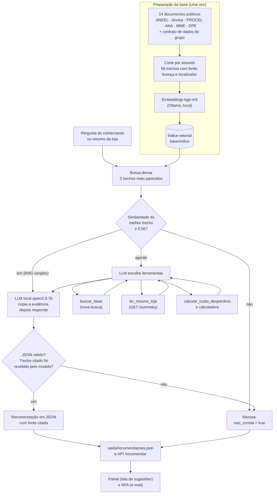
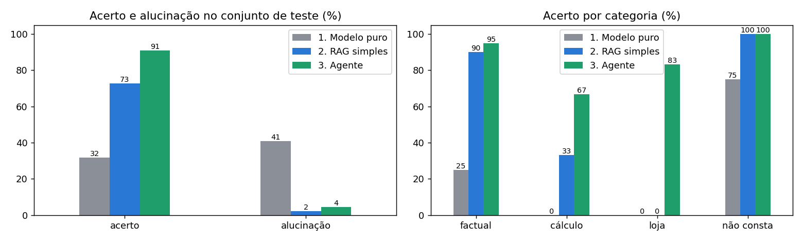

# Relatório · Generative AI for Engineering

**FIAP · Global Solution 2026.2 · CitizenTech · 4ES**
**Atividade:** Treinamento de uma LLM local · **Professor:** Francisco Elanio Bezerra
**Produto:** Energia que dá Lucro · **Componente:** Inteligência (Consultor de Eficiência Energética)

Resultado em uma linha: no conjunto de teste (44 perguntas), o mesmo modelo local acertou **31,8%** sem contexto, **72,7%** com RAG simples e **90,9%** como agente com ferramentas, enquanto a taxa de alucinação caiu de **40,9%** para **2,3%** e **4,5%**.

---

## 01 · Integrantes

| Nome completo | RM |
|---|---|
| Gustavo Henrique Santos Bonfim | RM98864 |
| João Pedro Marques | RM98307 |
| Kayky Paschoal Ribeiro | RM99929 |
| Lucas Yuji Farias Umada | RM99757 |
| Natan Eguchi dos Santos | RM98720 |

---

## 02 · Ficha Técnica e o que a IA resolve

| Campo | Conteúdo |
|---|---|
| Nome do produto | Energia que dá Lucro (nome provisório) |
| Cidadão e território | Donos e funcionários de pequenos comércios de bairro (mercadinhos, padarias, açougues, lojas) em cidades brasileiras |
| Problema, em uma frase | O pequeno comerciante paga caro de energia sem saber quais hábitos e equipamentos causam o desperdício |
| Proposta de valor | Mostrar o desperdício em reais, avisar na hora em que ele acontece e sugerir ações simples, usando as câmeras que a loja já tem |
| Arquitetura: componentes | Detecção por câmera (Visão) · robô com sensores (Físico) · API e painel do comerciante (Produção) · pipeline de dados (Dados) · **consultor de eficiência com LLM local (Inteligência, este repositório)** · alertas e resumos automáticos (Automação) · modelo de negócio (Pitch) |
| Fontes de dados | Clima (Open-Meteo) · tarifas e bandeiras (ANEEL) · eventos e consumo das lojas (simulados, com geração documentada) |
| Modelos de IA utilizados | YOLO treinado para portas de refrigeração abertas · **LLM local `qwen2.5:7b` com base de conhecimento (RAG) e agente com ferramentas; embeddings `bge-m3`** · IA embarcada no robô |
| URL do MVP e repositório | MVP: sem URL pública nesta entrega. É uma landing page com um painel administrativo em que o cliente vê os dashboards; o painel recebe o JSON de recomendações gerado aqui (`saida/recomendacoes.json`) · Repositório deste componente: <https://github.com/GBonfim07/GS-IA-4ESR> |
| Indicadores de impacto | R$ e kWh de desperdício evitados por loja ao mês · tempo médio de porta aberta · percentual de alertas resolvidos em poucos minutos · número de lojas ativas |
| ODS conectados | ODS 7 (energia acessível e limpa) e ODS 12 (consumo e produção responsáveis); do slide oficial, ODS 9, 11 e 13 |

### O que a IA resolve

**Problema escolhido entre os três do enunciado:** energia.

O painel mostra ao comerciante quanto ele desperdiçou. Falta dizer o que fazer. O Consultor recebe o resumo de desperdício de uma loja, ou uma pergunta do comerciante, e devolve uma recomendação curta, em JSON, **citando o trecho de fonte pública que a sustenta**. Se a base não cobre o assunto, ele responde "não consta" em vez de inventar.

| | |
|---|---|
| Entrada | pergunta em texto livre, ou resumo da loja no formato do `GET /summary` do painel |
| Saída | `{"loja_id", "periodo", "nao_consta", "recomendacao", "fonte": {"titulo", "trecho_id"}}` (contrato da seção 3 do guia do grupo) |
| Quem consome | o painel (tela de sugestões) e a automação RPA (resumo por e-mail), pelo arquivo `saida/recomendacoes.json` |
| Onde roda | na máquina de quem opera, com Ollama. Nada vai para a nuvem |

**Como contribui para os ODS.** ODS 7: reduz o consumo de energia do pequeno comércio com orientação baseada em fontes oficiais (PROCEL, ANEEL). ODS 12: ataca o desperdício (porta de refrigeração aberta, luz acesa sem necessidade) sem comprometer a conservação dos alimentos, porque a base inclui as temperaturas exigidas pela Anvisa.

---

## 03 · Diagrama do pipeline de IA

O código de cada etapa está em `src/consultor/`: `base.py` (trechos), `busca.py` (índice e busca), `geracao.py` (modelo puro, RAG e verificador), `agente.py` e `ferramentas.py` (especialização), `avaliacao.py` (correção e métricas), `api.py` (endpoint local).

**Três camadas de recusa.** (1) Limiar da busca: se o melhor trecho é pouco parecido com a pergunta, a LLM nem é chamada. (2) Regra "sem evidência, sem resposta": o modelo precisa copiar a frase que sustenta a resposta antes de decidir se responde. (3) Verificador de citação: se o `trecho_id` citado não está entre os que o modelo recebeu, a resposta é descartada.

---

## 04 · Tabela da base de conhecimento

| # | Fonte | Órgão | Formato | Licença | Trechos |
|---|---|---|---|---|---:|
| 1 | [Bandeiras Tarifárias](https://www.gov.br/aneel/pt-br/assuntos/tarifas/bandeiras-tarifarias) | ANEEL | HTML | CC BY-ND 3.0 (gov.br) | 3 |
| 2 | [Tarifa Branca](https://www.gov.br/aneel/pt-br/assuntos/tarifas/tarifa-branca) | ANEEL | HTML | CC BY-ND 3.0 (gov.br) | 3 |
| 3 | [Perguntas frequentes sobre Tarifa Branca](https://www.gov.br/aneel/pt-br/assuntos/tarifas/tarifa-branca/perguntas-frequentes-sobre-tarifa-branca) | ANEEL | HTML | CC BY-ND 3.0 (gov.br) | 6 |
| 4 | [Postos Tarifários](https://www.gov.br/aneel/pt-br/assuntos/tarifas/entenda-a-tarifa/postos-tarifarios) | ANEEL | HTML | CC BY-ND 3.0 (gov.br) | 3 |
| 5 | [Modalidades Tarifárias](https://www.gov.br/aneel/pt-br/assuntos/tarifas/entenda-a-tarifa/modalidades-tarifarias) | ANEEL | HTML | CC BY-ND 3.0 (gov.br) | 2 |
| 6 | [Programa de Eficiência Energética (PEE)](https://www.gov.br/aneel/pt-br/assuntos/programa-de-eficiencia-energetica) | ANEEL | HTML | CC BY-ND 3.0 (gov.br) | 1 |
| 7 | [Chamadas Públicas do PEE](https://www.gov.br/aneel/pt-br/assuntos/programa-de-eficiencia-energetica/chamadas-publicas) | ANEEL | HTML | CC BY-ND 3.0 (gov.br) | 1 |
| 8 | [PEE da ANEEL, Guia de EE para Municípios, vol. III](https://www.gov.br/mme/pt-br/assuntos/ee/guia-para-municipios/guia_de_ee_para_municipios/volume-iii/fontes-de-recursos-do-governo-a-fundo-perdido/programa-e-eficiencia-energetica-pee-da-aneel) | MME | HTML | CC BY-ND 3.0 (gov.br) | 2 |
| 9 | [RDC nº 216/2004, Boas Práticas para Serviços de Alimentação](https://bvsms.saude.gov.br/bvs/saudelegis/anvisa/2004/res0216_15_09_2004.html) | Anvisa | HTML | Ato oficial, sem proteção autoral (Lei 9.610/1998, art. 8º, IV) | 7 |
| 10 | [Eficiência Energética em Sistemas de Refrigeração Industrial e Comercial](https://wiki.sj.ifsc.edu.br/images/9/92/0_Eficiencia_energetica_sistemas_de_refrigera%c3%a7%c3%a3o.pdf) | Eletrobras / PROCEL | PDF (livro, 2005) | Direitos reservados; usada só como síntese própria | 11 |
| 11 | [Dicas para evitar o desperdício de energia (A3P)](https://www.gov.br/ana/pt-br/todos-os-documentos-do-portal/documentos-gab/cosus/dicas-ambientais-da-a3p-evitamento-desperdicio-de-energia.pdf) | ANA | PDF | CC BY-ND 3.0 (gov.br) | 5 |
| 12 | [Campanhas: dicas da energia](https://www.gov.br/ana/pt-br/todos-os-documentos-do-portal/documentos-gab/cosus/campanhas-dicas-da-energia.pdf) | ANA | PDF | CC BY-ND 3.0 (gov.br) | 4 |
| 13 | [ABCDEnergia, Eficiência Energética](https://www.epe.gov.br/pt/abcdenergia/eficiencia-energetica) | EPE | HTML | Não informada; usada só como síntese própria | 2 |
| 14 | Guia do grupo, seção 3 (contrato de dados e fórmula de custo) | Grupo | Markdown | Autoria própria | 6 |
| | **Total** | | | | **56** |

Todas as fontes foram acessadas em 10/11/2026. Os trechos têm de 197 a 722 caracteres (mediana de 406), cortados por assunto e não por tamanho fixo, e cada um registra onde está no documento original (seção, item ou página). Os detalhes de como foram feitos estão em [`base/README.md`](base/README.md), e a tabela completa, com datas, em [`base/fontes.json`](base/fontes.json).

---

## 05 · Performance das configurações

### 5.1 Como foi medido

- **Modelo:** `qwen2.5:7b` (4,7 GB) servido pelo Ollama 0.40.16, 100% na GPU (Radeon RX 7800 XT, 16 GB), cerca de 67 tokens por segundo. Temperatura 0 e semente fixa. **Embeddings:** `bge-m3`.
- **Casos de teste:** 74 perguntas com gabarito em [`avaliacao/casos_teste.jsonl`](avaliacao/casos_teste.jsonl), em dois conjuntos.

| Conjunto | Uso | Factual | Cálculo | Loja | Não consta | Total |
|---|---|---:|---:|---:|---:|---:|
| Calibração | ajustar limiar e prompts | 16 | 3 | 2 | 9 | 30 |
| **Teste** | **só medir, depois de tudo congelado** | 20 | 6 | 6 | 12 | **44** |

- **Acerto:** em caso respondível, o modelo respondeu e a resposta contém os fatos do gabarito; em caso "não consta", recusou.
- **Alucinação:** respondeu o que não consta; afirmou número, prazo ou conclusão que contradiz o gabarito; citou fonte inexistente; ou apresentou dado de loja que não confere.
- **Correção:** automática, por regras ([`src/consultor/avaliacao.py`](src/consultor/avaliacao.py)), seguida da leitura das 132 respostas do teste. A leitura registrou 19 ajustes, cada um com justificativa, em [`avaliacao/revisao_manual.json`](avaliacao/revisao_manual.json). O placar mostra a alucinação com e sem essa revisão.

### 5.2 Busca: recall@1 e recall@3

recall@k é a fração das perguntas em que algum trecho relevante do gabarito aparece entre os k primeiros.

| Busca | Conjunto | Perguntas | recall@1 | recall@3 |
|---|---|---:|---:|---:|
| BM25 (palavras) | calibração | 19 | 0,789 | 0,895 |
| BM25 (palavras) | teste | 28 | 0,786 | 0,857 |
| **Densa (`bge-m3`)** | calibração | 19 | 0,789 | 0,947 |
| **Densa (`bge-m3`)** | **teste** | **28** | **0,786** | **0,929** |

A busca densa foi adotada: empata com o BM25 no primeiro resultado e é melhor no top 3. No teste, as duas perguntas sem trecho relevante no top 3 são perguntas sobre uma loja, cuja resposta está no resumo e não na base.

### 5.3 Limiar de recusa e justificativa

O limiar é a similaridade mínima do melhor trecho para a LLM ser chamada.

**Critério, fixado antes de olhar o teste:** o maior limiar que não barra nenhuma pergunta respondível da calibração, menos 0,02 de margem. Barrar uma pergunta legítima deixa o comerciante sem resposta e não tem segunda chance; deixar passar uma pergunta sem resposta não é fatal, porque a LLM e o verificador de citação ainda podem recusar.

A menor similaridade entre as respondíveis da calibração foi 0,579, então o limiar ficou em **0,56**.

| Limiar 0,56 | Respondíveis mantidas | "Não consta" barradas |
|---|---:|---:|
| Calibração | 100,0% | 88,9% |
| Teste | 88,5% | 91,7% |

No teste o limiar barrou 11 das 12 perguntas sem resposta, mas também 3 das 26 respondíveis (perguntas sobre loja ficam fora dessa conta). Essa perda aparece no placar do RAG e é o primeiro dos cinco erros analisados. O gráfico das distribuições está em `avaliacao/limiar.png` e no notebook 01.

### 5.4 Placar das três configurações (conjunto de teste, 44 casos)

| Configuração | Acerto | Alucinação (com revisão manual) | Alucinação (só automática) | Recusa correta | Recusa indevida | Citação correta | JSON válido | Tempo médio |
|---|---:|---:|---:|---:|---:|---:|---:|---:|
| 1. Modelo puro (sem contexto) | 31,8% | 40,9% | 9,1% | 75,0% | 25,0% | 0,0% | 100% | 2,7 s |
| 2. RAG simples | 72,7% | 2,3% | 0,0% | 100% | 34,4% | 100% | 100% | 2,2 s |
| **3. Agente com ferramentas** | **90,9%** | 4,5% | 0,0% | 100% | 6,2% | 100% | 100% | 8,4 s |

Em número de casos: acertos 14, 32 e 40 de 44; alucinações 18, 1 e 2 de 44.

**Acerto por categoria**

| Configuração | Factual (20) | Cálculo (6) | Loja (6) | Não consta (12) |
|---|---:|---:|---:|---:|
| 1. Modelo puro | 25,0% | 0,0% | 0,0% | 75,0% |
| 2. RAG simples | 90,0% | 33,3% | 0,0% | 100% |
| 3. Agente com ferramentas | 95,0% | 66,7% | 83,3% | 100% |

### 5.5 Interpretação

**A base de conhecimento é o que reduz a alucinação.** O modelo puro respondeu com segurança a perguntas cuja resposta ele não tinha: alucinou em 15 das 32 perguntas respondíveis. Em 14 afirmou um número, prazo ou conclusão errados (por exemplo, "28º dia útil" para um prazo que é de 180 dias, e "10 ºC" para um limite que é 5 ºC) e em 1 inventou um dado de loja. Também respondeu 3 das 12 perguntas que não constam. Com os trechos, o mesmo modelo acertou 18 das 20 perguntas factuais e a alucinação caiu de 40,9% para 2,3%. A maior parte do acerto do modelo puro (9 dos 14 casos) vem de recusar perguntas sem resposta, e não de responder bem.

**O RAG simples é seguro, mas recusa demais.** Ele não respondeu nada que não consta (recusa correta de 100%) e toda resposta dada citou um trecho relevante. O custo é a recusa indevida de 34,4%: 11 perguntas respondíveis ficaram sem resposta. Seis delas são perguntas sobre uma loja, que o RAG não tem como responder porque só enxerga a base; três foram barradas pelo limiar; duas, pela própria LLM, por falta do trecho certo no contexto.

**O agente ganha onde o RAG não alcança.** O agente acertou 8 casos que o RAG errou e não perdeu nenhum que o RAG acertou. Os ganhos vêm de três capacidades: ler o resumo da loja (5 dos 6 casos de loja), calcular com ferramenta (R$ 5,40 e R$ 1,65 exatos, onde o RAG recusou) e refazer a busca com outras palavras (recuperou uma pergunta que o limiar tinha barrado).

**A comparação justa entre RAG e agente.** A categoria "loja" favorece o agente por construção, já que o RAG não recebe os dados da loja. Sem ela, em 38 casos, o RAG acerta 84,2% e o agente 92,1%. O ganho continua, mas é menor.

**O que o agente custa.** Ele é quase quatro vezes mais lento (8,4 s contra 2,2 s), porque faz várias chamadas ao modelo (até sete por pergunta). E teve uma alucinação a mais que o RAG: num caso em que a busca não trouxe o trecho certo, o RAG recusou e o agente completou a resposta por conta própria (erro 4 abaixo). Responder mais aumenta a exposição ao erro.

**JSON válido em 100% nas três configurações.** A saída é gerada com decodificação restrita por JSON Schema e validada com pydantic, então o formato deixa de depender do modelo. Nas recusas decididas pelo código (20 do RAG, pelo limiar, e 12 do agente, por falta de evidência), o JSON de recusa é montado pelo próprio código, sem chamar a LLM para escrever.

**Limites desta medição.**
- O conjunto de teste tem 44 casos: cada caso vale 2,3 pontos percentuais. A diferença entre RAG (2,3%) e agente (4,5%) em alucinação é de um único caso.
- Foi medido um modelo, com uma semente. Outros modelos locais podem se comportar de outro jeito.
- **O resultado varia um pouco de uma rodada para outra, mesmo com temperatura 0 e semente fixa.** O conjunto de teste foi executado uma segunda vez, na mesma máquina e com o mesmo código ([`avaliacao/repeticao/`](avaliacao/repeticao/)). O RAG repetiu o placar exato. O modelo puro e o agente mudaram em um caso cada: acerto de 34,1% e 88,6%, alucinação de 38,6% e 6,8%. A ordem das configurações e as conclusões não mudam, e os quatro erros do agente analisados abaixo se repetiram. Diferenças de um ou dois casos entre configurações não devem ser lidas como significativas.
- O gabarito e a revisão manual foram feitos pelo próprio grupo. As respostas completas estão em `avaliacao/resultados/` para conferência.
- Na calibração, usada para ajustar os prompts, os números são mais altos (43,3%, 86,7% e 100%). A queda no teste mostra por que os dois conjuntos precisam ficar separados. As rodadas de desenvolvimento na calibração, antes e depois dos ajustes de prompt, estão em `avaliacao/iteracoes/`: na primeira, o agente acertava 43,3% porque quase não chamava as ferramentas; a busca inicial obrigatória e a síntese em duas fases corrigiram isso.

### 5.6 Demonstração de alucinações do modelo puro

Respostas reais do modelo sem contexto no conjunto de teste (todas em `avaliacao/resultados/teste_puro.jsonl`):

| Pergunta | Resposta do modelo puro | Correto, segundo a base |
|---|---|---|
| Desde que ano existe o sistema de bandeiras tarifárias? | "existe desde 2010" | 2015 (ANEEL) |
| Qual é a temperatura máxima para conservar alimentos preparados sob refrigeração? | "é de 10 °C (50 °F)" | inferior a 5 ºC (Anvisa, RDC 216) |
| Em quanto tempo a distribuidora precisa atender meu pedido de tarifa branca? | "até 48 horas para agendar a visita e até 10 dias úteis" | até 30 dias (ANEEL) |
| Os expositores ficaram 40 horas com a porta aberta. Qual o desperdício com os valores padrão? | "R$ 160,00" | R$ 5,40 |
| Vale a pena instalar banco de capacitores na padaria? (não consta) | "Sim, vale a pena [...]" | a base não trata do assunto |

---

## 06 · Os cinco erros, a causa e a correção proposta

Erros reais do conjunto de teste, com a saída gravada. O notebook 04 mostra cada um com todos os detalhes.

### Erro 1 · O limiar de recusa barrou uma pergunta que a base responde

| | |
|---|---|
| Configuração e caso | RAG simples, `t16` |
| Pergunta | Como evitar que a luz do estoque fique acesa sem ninguém lá dentro? |
| Esperado | Usar sensores de presença e desligar as luzes das dependências que não estão em uso |
| Saída real | `{"nao_consta": true, "recomendacao": "", "fonte": null}`, decisão `recusa_limiar` |
| **Causa** | A busca achou o trecho certo em primeiro lugar (`ana-dicas-02`), mas com similaridade 0,549, abaixo do limiar de 0,56. O limiar foi calibrado com 19 perguntas; esta usa uma redação coloquial mais distante do texto da fonte do que qualquer uma da calibração. A LLM nem foi chamada. O mesmo ocorreu em `t21` e `t24`. |
| **Correção proposta** | Trocar o corte seco por uma faixa de dúvida: abaixo de 0,45 recusa direto; entre 0,45 e 0,56 os trechos seguem para a LLM, que decide com a regra "sem evidência, sem resposta". Recalibrar com mais perguntas em linguagem de balcão. No agente o erro já não acontece: ele refez a busca com outras palavras, passou do limiar e acertou este caso. |

### Erro 2 · Conta feita de cabeça, com erro de casa decimal

| | |
|---|---|
| Configuração e caso | Agente, `t26` (o RAG simples errou igual) |
| Pergunta | Quantos kWh são desperdiçados em 6 horas de porta aberta em um expositor, pelos valores padrão do produto? |
| Esperado | 0,50 kW × 0,30 × 6 h = 0,9 kWh |
| Saída real | "Com base nos valores padrão, 0,50 kW de potência e 0,30 de fator de perda, 6 horas de porta aberta resultam em **0,09 kWh** de energia desperdiçada. [...]" Fonte citada: `produto-contrato-01` |
| **Causa** | A pergunta pedia kWh, e não reais. A busca inicial trouxe a fórmula e os valores certos; o agente considerou que já tinha tudo e parou sem chamar `calcular_custo_desperdicio`, embora a instrução mande usar a ferramenta em qualquer conta de custo ou de kWh e nunca fazer conta de cabeça. Na síntese, multiplicou por conta própria e errou a casa decimal. O nome da ferramenta fala em "custo", o que pode ter pesado, mas o fato é que a instrução sozinha não bastou. A citação estava correta, então o verificador não tinha como barrar: ele confere a fonte, não a conta. |
| **Correção proposta** | Não depender só da instrução. Acrescentar um verificador numérico: todo número da resposta precisa aparecer na pergunta, em um trecho recebido ou no resultado de uma ferramenta de cálculo; se não aparecer, o código chama a ferramenta e refaz a síntese, ou recusa. A geração em lote já tem uma conferência desse tipo para o valor em reais (`lote.valores_conferem`). Renomear a ferramenta para `calcular_desperdicio`, para o nome não sugerir que ela só serve para custo. |

### Erro 3 · O agente procurou na base um dado que estava no resumo da loja

| | |
|---|---|
| Configuração e caso | Agente, `t32` |
| Pergunta | Quantos eventos de porta aberta o freezer-2 do mercado-01 teve em 2026-10? |
| Esperado | 278 eventos |
| Saída real | `{"nao_consta": true, ...}`, decisão `recusa_sem_evidencia`. Ferramenta escolhida: `buscar_base("eventos de porta aberta freezer-2 mercado-01 2026-10")` |
| **Causa** | O dado está no resumo da loja, mas o agente buscou duas vezes na base de conhecimento e não chamou `ler_resumo_loja`. A descrição da ferramenta menciona "total em R$ e kWh" e não fala em quantidade de eventos. Sem evidência, o sistema recusou: recusa indevida, sem alucinação. |
| **Correção proposta** | Descrever na ferramenta todos os campos do resumo (eventos, duração, kWh e R$ por equipamento). Tirar essa decisão do modelo: quando a pergunta cita `padaria-01` ou `mercado-01`, o código chama `ler_resumo_loja` automaticamente, como já faz com a busca inicial. |

### Erro 4 · A busca não trouxe o trecho certo e o modelo completou por conta própria

| | |
|---|---|
| Configuração e caso | Agente, `t19` |
| Pergunta | Como um comércio pode apresentar um projeto ao Programa de Eficiência Energética da ANEEL? |
| Esperado | Pelas chamadas públicas de projetos, nas quais todos os interessados podem apresentar propostas |
| Saída real | "[...] o comércio pode adotar tecnologias e práticas que aumentam a eficiência energética, como a instalação de equipamentos com etiqueta A do Inmetro e Selo Procel, e então apresentar esse projeto à ANEEL ou a uma empresa de conservação de energia (ESCO) selecionada para participar do programa." Fonte citada: `aneel-pee-01` |
| **Causa** | A resposta está em `aneel-chamadas-01`, que ficou em quinto lugar na busca (0,562); o contexto recebeu três trechos que falam do programa, mas não de como participar. O agente não refez a busca e, na síntese, montou um procedimento que nenhum trecho descreve. Como a citação apontava para um trecho recebido, passou pelo verificador. Com os mesmos trechos, o RAG simples recusou. |
| **Correção proposta** | Combinar a busca densa com BM25: para esta pergunta o trecho correto é o terceiro no BM25, então a fusão das duas listas o traria para o contexto. Fortalecer o verificador: conferir também se a evidência copiada contém os termos centrais da resposta; se a resposta descreve um procedimento que não está na evidência, recusar. |

### Erro 5 · Sem contexto, o modelo inventou um prazo com aparência de regra

| | |
|---|---|
| Configuração e caso | Modelo puro, `t07` |
| Pergunta | Se eu sair da tarifa branca e me arrepender, quando posso aderir de novo? |
| Esperado | Só depois de 180 dias do retorno à tarifa convencional |
| Saída real | "Você pode aderir novamente à tarifa branca a partir do **28º dia útil** após a rescisão da sua conta, desde que não haja débitos não quitados." Fonte: `null` |
| **Causa** | O modelo não tem a regra da ANEEL e mesmo assim respondeu com um prazo específico e uma condição que não existem. É a alucinação típica do modelo sem base: plausível, específica e sem fonte. |
| **Correção proposta** | É o erro que a base corrige. Com os trechos, o RAG simples e o agente responderam "180 dias", citando `aneel-tb-faq-05`. A configuração sem contexto não deve ser exposta ao comerciante. |

### Outros problemas observados

- Em `t21` a busca inicial ficou a 0,001 do limiar (0,5588) e o agente desistiu sem chamar a ferramenta de cálculo, embora a pergunta fosse uma conta.
- Em `t14` e `t41` o agente chamou `calcular_custo_desperdicio` com parâmetros que a pergunta não trazia (por exemplo, 1,5 kW e R$ 0,55/kWh). O resultado não entrou na resposta, mas o risco existe.
- Fora do conjunto de teste, na demonstração do notebook 03: à pergunta "Qual equipamento do mercado-01 mais desperdiçou em 2026-11?", o agente leu o resumo certo e respondeu `freezer-2` (R$ 0,76), quando o maior desperdício era a iluminação do estoque (R$ 3,23). Com a pergunta refeita como "maior desperdício", acertou. O modelo não tratou a iluminação como "equipamento". Correção proposta: a ferramenta devolver, além do resumo, o campo `maior_desperdicio` já calculado.
- Em `t39` e `t42` o agente repetiu a busca seis vezes com pequenas variações antes de recusar. A resposta foi correta, mas levou mais tempo do que o necessário.
- Na segunda execução do teste, o agente errou `t10`: respondeu que a temperatura máxima para conservar alimentos preparados é "4 ºC", citando o trecho que fala do prazo de consumo (5 dias a 4 ºC), quando o limite da norma é "inferior a 5 ºC". Na primeira execução tinha respondido certo. Dois trechos vizinhos com números parecidos bastam para a resposta virar de uma rodada para outra.

---

## 07 · Conclusão técnica e links

**O que foi provado.** Uma LLM de 7 bilhões de parâmetros, rodando em uma placa de vídeo doméstica, deixa de ser um risco e passa a ser útil quando responde só com base em fontes citadas. No teste, o acerto subiu de 31,8% para 72,7% com RAG e para 90,9% com o agente, e a alucinação caiu de 40,9% para menos de 5%.

**O que cada camada entrega.** A base com fonte dá a resposta certa e a citação. O limiar, a regra de evidência e o verificador de citação dão a recusa. A decodificação restrita dá o JSON válido. O agente dá o que o texto da base não tem: os números da loja e a conta exata.

**Segurança, explicabilidade e LGPD.**
- A LLM e os embeddings rodam na máquina local; nenhuma pergunta ou dado de loja sai dela.
- O componente não recebe imagens nem dados pessoais: trabalha com identificadores de loja e de equipamento. A API não grava a pergunta; o log guarda só um hash.
- Toda resposta traz o trecho citado, que pode ser lido em `GET /trechos/{id}`, e um campo `explicacao` com a decisão tomada, os trechos consultados, a similaridade e as ferramentas usadas.
- A IA só sugere. Quem decide e age é o comerciante.
- A API escuta apenas em `127.0.0.1`, limita o tamanho da pergunta, aceita chave por `X-API-Key` e trata o conteúdo da pergunta como dado (teste de injeção de instrução no notebook 02). A calculadora do agente só aceita aritmética. O resumo de loja recebido pela API é validado campo a campo, e o valor em reais de cada recomendação em lote é conferido contra o resumo.

**Limites e próximos passos.**
1. Aplicar as correções dos erros 1 a 4 e medir de novo em perguntas novas, porque o conjunto de teste atual já foi visto. Medir cada configuração em pelo menos três rodadas e reportar a média, já que o resultado varia um caso de uma rodada para outra.
2. Ampliar o conjunto de teste e pedir a correção a alguém de fora do grupo.
3. Trocar os valores provisórios da fórmula de custo por valores com fonte (tarifa da distribuidora na ANEEL e potência do equipamento no selo PROCEL).
4. Atualizar os valores das bandeiras tarifárias sempre que a ANEEL os revisar.
5. Ligar `PAINEL_URL` quando a API do painel estiver no ar, para ler o resumo direto do `GET /summary`.

**Links**

| | |
|---|---|
| Repositório | <https://github.com/GBonfim07/GS-IA-4ESR> |
| Notebooks com saídas | [`notebooks/`](notebooks/) |
| Base de conhecimento | [`base/`](base/) |
| Casos de teste, resultados e placar | [`avaliacao/`](avaliacao/) |
| Como reproduzir | [`README.md`](README.md) |
